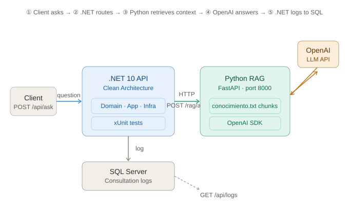

# AI RAG .NET + Python Monorepo

[](https://github.com/rambmario/dotnet-rag-api/actions/workflows/ci.yml)
[](LICENSE)

AI Q&A system: Python RAG (FastAPI + OpenAI embeddings) + .NET 8 Clean Architecture API + SQL Server logging + xUnit/pytest + Docker Compose + GitHub Actions CI.

Portfolio project showing how to integrate AI capabilities into a production-style .NET backend.

## Highlights

- Python Retrieval-Augmented Generation with OpenAI embeddings (keyword fallback).
- .NET 8 Web API structured with Clean Architecture.
- API key authentication, ProblemDetails, rate limiting, and health checks.
- HTTP orchestration with Polly-based resilience on the RAG client.
- SQL Server persistence for consultation audit logs.
- Unit/integration tests and CI coverage artifacts.
- One-command local stack via Docker Compose.

## Built by

Mario Ramb - Systems Engineer with 18+ years in enterprise .NET development.
This project demonstrates AI integration on top of a production-grade .NET backend.

[LinkedIn](https://www.linkedin.com/in/marioramb/) · [GitHub](https://github.com/rambmario)

## Repository Structure

```text
dotnet-rag-api/
|-- rag-service/        # Python FastAPI RAG service
|-- DotnetRagApi/       # .NET 8 API + Clean Architecture layers + tests
|-- docker/             # SQL init scripts for Compose
|-- docs/               # Architecture diagram
|-- docker-compose.yml
`-- LICENSE
```

## Tech Stack

- Python, FastAPI, OpenAI SDK (embeddings + chat), python-dotenv, pytest
- .NET 8, ASP.NET Core Web API, Dapper
- SQL Server
- Docker Compose
- xUnit + coverlet, GitHub Actions

## Architecture Overview

1. Client sends a question to the .NET endpoint (`POST /api/ask`) with `X-Api-Key`.
2. Application use case invokes the Python RAG service (`POST /rag/ask`).
3. Python retrieves relevant context with embeddings (or keyword fallback) and calls an LLM.
4. Response returns to .NET and the use case persists an audit row in SQL Server.
5. Logs can be queried from `GET /api/logs` (authenticated).

## Architecture



## Quick Start with Docker Compose

Prerequisites: Docker Desktop, an OpenAI API key.

```powershell
copy .env.example .env
# edit .env and set OPENAI_API_KEY

docker compose up --build
```

Then open:

- Swagger: `http://localhost:5000/swagger`
- Health: `http://localhost:5000/health`
- Readiness: `http://localhost:5000/health/ready`

Default API key (override with `API_KEY` in `.env`):

```text
change-me-demo-api-key
```

Example request:

```bash
curl -X POST http://localhost:5000/api/ask \
  -H "Content-Type: application/json" \
  -H "X-Api-Key: change-me-demo-api-key" \
  -d "{\"pregunta\":\"What is retrieval augmented generation?\",\"usuario\":\"demo\",\"rol\":\"user\",\"topN\":2}"
```

## Manual Local Setup

### Prerequisites

- .NET SDK 8+
- Python 3.10+
- SQL Server LocalDB / SQL Server / Docker SQL
- OpenAI API key

### 1) Run the Python RAG Service

From `rag-service`:

```powershell
python -m venv .venv
.\.venv\Scripts\Activate.ps1
pip install -r requirements.txt
copy .env.example .env
```

Start:

```powershell
uvicorn app:app --host 127.0.0.1 --port 8000 --reload
```

### 2) Create the SQL database

Run:

- `DotnetRagApi/database/create-database.sql`

### 3) Run the .NET API

Copy `DotnetRagApi/DotnetRagApi.Api/appsettings.example.json` to `appsettings.json` and set:

- `ConnectionStrings:DefaultConnection`
- `Security:ApiKey`
- `RagApi:BaseUrl`

```powershell
cd DotnetRagApi
dotnet run --project .\DotnetRagApi.Api\DotnetRagApi.Api.csproj
```

## API Endpoints

| Method | Route | Auth | Description |
|--------|-------|------|-------------|
| `POST` | `/api/ask` | `X-Api-Key` | Ask a question through RAG |
| `GET` | `/api/logs?top=50` | `X-Api-Key` | Latest audit logs (`top` clamped 1..100) |
| `GET` | `/health` | No | Liveness |
| `GET` | `/health/ready` | No | SQL + Python readiness |

## Tests

.NET:

```powershell
cd DotnetRagApi
dotnet test .\DotnetRagApi.slnx
```

Python:

```powershell
cd rag-service
pytest -q
```

## Why It Works As A Portfolio Project

- Demonstrates practical AI integration instead of isolated toy logic.
- Applies Clean Architecture so business orchestration stays testable.
- Shows cross-language integration (Python + .NET) with resiliency and health checks.
- Includes authentication, Docker packaging, automated tests, and CI.

## Notes

- Domain/DTO fields intentionally use Spanish naming (`pregunta`, `respuesta`) to match the business vocabulary.
- Retrieval defaults to OpenAI embeddings (`RAG_RETRIEVAL_MODE=embeddings`) with keyword fallback.
- For cloud hosting, the Compose services map cleanly to Azure Container Apps / App Service + Azure SQL.

## License

MIT - see [LICENSE](LICENSE).
